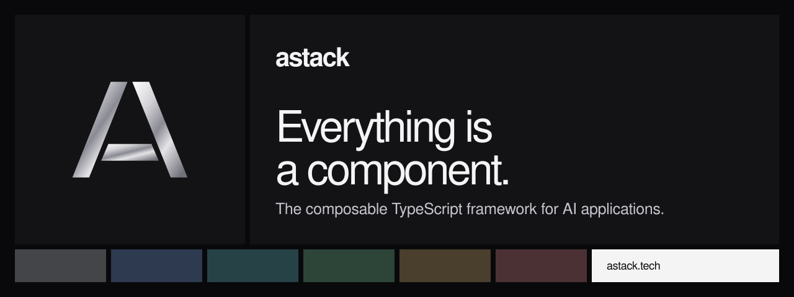

# AStack



[Website](https://astack.tech) · [Docs](https://astack.tech/docs) · [Examples](https://astack.tech/examples) · [Changelog](https://github.com/astack-tech/astack/releases) · [Contributing](./.github/CONTRIBUTING.md)

English · [简体中文](./README.zh-CN.md)

[](https://github.com/astack-tech/astack/actions/workflows/ci.yml) [](https://www.npmjs.com/package/@astack-tech/core) [](./LICENSE)

> **Public beta.** APIs can change between beta releases. Each release is described in the package changelogs.

AStack is a TypeScript framework for AI applications. It has one rule: **everything is a component**. Models, tools, agents and your own logic are components. A pipeline connects their ports into a graph, and data flows along the connections.

```typescript
import { Pipeline } from '@astack-tech/core';

// Trim and Uppercase are two small components; see examples/pipeline.
const pipeline = new Pipeline();
pipeline.addComponent('trim', new Trim());
pipeline.addComponent('upper', new Uppercase());
pipeline.connect('trim.out', 'upper.in');

await pipeline.run('trim.in', '  hello  '); // 'HELLO'
```

## The computation model

| Idea      | What it is                                                              | API                                      |
| --------- | ----------------------------------------------------------------------- | ---------------------------------------- |
| Component | A unit of work with named input and output ports                        | `class X extends Component`              |
| Port      | A channel. Output ports connect to input ports.                         | `$i('in').receive()`, `$o('out').send()` |
| Pipeline  | A graph of components that runs data from a trigger port to an endpoint | `addComponent`, `connect`, `run`         |

A component never calls another component. It reads its input ports and writes its output ports, and the pipeline decides where data goes. Each component stays small and testable, and you can rewire a graph without editing the components in it.

Every component works in two modes: call `run(input)` like a function, or add it to a pipeline, where the runtime calls `_transform($i, $o)`. Agents, multi-step workflows and routing are patterns built from these ideas, not separate subsystems.

The runtime is [HLang](https://github.com/hlang-tech/hlang), a flow-based programming runtime built on RxJS. Each connection is an observable stream.

## How AStack compares

AStack's computation model is original. [PocketFlow](https://the-pocket.github.io/PocketFlow/) reached a similar idea independently: a small core in which the graph _is_ the framework. PocketFlow is written in Python and makes a 100-line core its defining goal. AStack does not optimize for line count; it optimizes for typed, reactive data flow in TypeScript. [Haystack](https://github.com/deepset-ai/haystack) inspired AStack's API shape. AStack does not use Haystack code.

|                | AStack                                                        | PocketFlow                                                             | Haystack                            |
| -------------- | ------------------------------------------------------------- | ---------------------------------------------------------------------- | ----------------------------------- |
| Language       | TypeScript                                                    | Python                                                                 | Python                              |
| Unit of work   | Component with named ports                                    | Node with `prep`, `exec` and `post`                                    | Component with typed sockets        |
| How data moves | Along each connection, from an output port to an input port   | Through a shared store that nodes read and write                       | Along connections between sockets   |
| Branching      | A component sends to the output port it chooses               | `post` returns an action; the flow follows that labeled edge           | Router components                   |
| Execution      | Reactive streams; concurrent runs of a route resolve in order | A flow runs nodes one after another; async and parallel variants exist | A pipeline run loop                 |
| Design goal    | A typed, reactive data-flow model                             | A minimal core of about 100 lines                                      | A full framework for search and RAG |

The main difference from PocketFlow is where state lives. PocketFlow nodes share one store. In AStack each connection carries the data for that step, so every input and output is visible in the graph. Details: [Introduction](https://astack.tech/docs/introduction).

## Install

Requires Node.js 20 or later.

```bash
npm install @astack-tech/core@beta @astack-tech/components@beta
# Model providers and tools
npm install @astack-tech/integrations@beta @astack-tech/tools@beta
```

## An agent in a few lines

```typescript
import { Agent } from '@astack-tech/components';
import { ModelProvider } from '@astack-tech/integrations';
import { createTool } from '@astack-tech/tools';

const multiply = createTool(
  'multiply',
  'Multiply two numbers.',
  args => Number(args['a']) * Number(args['b'])
);

const agent = new Agent({
  model: new ModelProvider.Deepseek({ apiKey: process.env['DEEPSEEK_API_KEY'] ?? '' }),
  tools: [multiply],
});

const { message, toolCalls } = await agent.run('What is 37 times 43?');
```

## Examples

Each example is one short file that shows one idea. Read them in order; the code is also rendered on [astack.tech/examples](https://astack.tech/examples).

| #   | Example                                       | Shows                                           | API key |
| --- | --------------------------------------------- | ----------------------------------------------- | ------- |
| 1   | [component](./examples/component)             | Define a component and run it as a function     | No      |
| 2   | [pipeline](./examples/pipeline)               | Connect components and infer the endpoint       | No      |
| 3   | [routing](./examples/routing)                 | Branch through named output ports               | No      |
| 4   | [text-splitter](./examples/text-splitter)     | Split documents with a built-in component       | No      |
| 5   | [tools](./examples/tools)                     | Create tools and run tool calls                 | No      |
| 6   | [chat](./examples/chat)                       | Call DeepSeek directly and in a pipeline        | Yes     |
| 7   | [workflow](./examples/workflow)               | Chain outline, draft and edit steps             | Yes     |
| 8   | [agent](./examples/agent)                     | Let a model call a tool                         | Yes     |
| 9   | [streaming-agent](./examples/streaming-agent) | Stream text and tool events                     | Yes     |
| 10  | [rlm-agent](./examples/rlm-agent)             | Question a codebase too large for one prompt    | Yes     |
| 11  | [http-server](./examples/http-server)         | Serve a streaming agent over Server-Sent Events | Yes     |

```bash
pnpm install && pnpm build
pnpm --filter @astack-examples/pipeline start
```

## Packages

| Package                                                | Contents                                                             |
| ------------------------------------------------------ | -------------------------------------------------------------------- |
| [`@astack-tech/core`](./packages/core)                 | `Component`, `Pipeline`, `Port`                                      |
| [`@astack-tech/components`](./packages/components)     | `Agent`, `StreamingAgent`, `RLMAgent`, `TextSplitter`, `ToolInvoker` |
| [`@astack-tech/tools`](./packages/tools)               | `createTool`, tool sets, component tools, MCP tools                  |
| [`@astack-tech/integrations`](./packages/integrations) | Model providers (`Deepseek`)                                         |

Each package README lists its full API.

## Documentation

| Page                                                                                                                                            | Topic                                          |
| ----------------------------------------------------------------------------------------------------------------------------------------------- | ---------------------------------------------- |
| [Introduction](https://astack.tech/docs/introduction)                                                                                           | The computation model and the comparison above |
| [Getting started](https://astack.tech/docs/getting-started)                                                                                     | Install, first component, first pipeline       |
| [Components](https://astack.tech/docs/components), [Pipelines](https://astack.tech/docs/pipelines), [Routing](https://astack.tech/docs/routing) | The core model                                 |
| [Tools](https://astack.tech/docs/tools), [Model providers](https://astack.tech/docs/model-providers)                                            | Building blocks for agents                     |
| [Agents](https://astack.tech/docs/agents), [Streaming](https://astack.tech/docs/streaming), [RLM](https://astack.tech/docs/rlm)                 | Agent patterns                                 |

## Development

```bash
pnpm install
pnpm verify   # format, lint, types, tests, package checks, build
```

The rules for contributors and AI coding agents are in [AGENTS.md](./AGENTS.md): code is the single source of truth, every change starts with a failing test, and every gate runs at its strictest setting with zero warnings. Open pull requests against `dev`. See [CONTRIBUTING.md](./.github/CONTRIBUTING.md) and [SECURITY.md](./SECURITY.md).

## License

[MIT](./LICENSE). Thanks to the [HLang](https://github.com/hlang-tech) project for the runtime, to [Haystack](https://github.com/deepset-ai/haystack) for the API inspiration, and to everyone who has contributed.
