# AStack

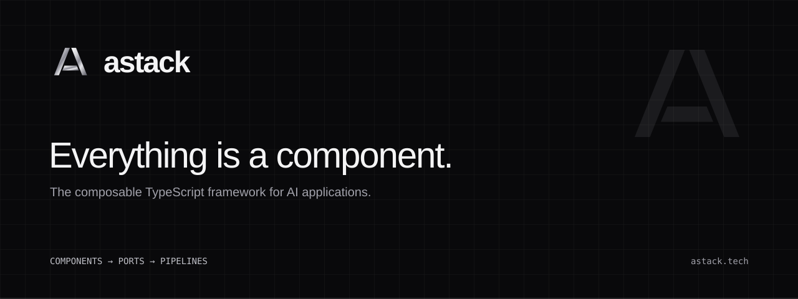

[Website](https://astack.tech) · [Documentation](https://deepwiki.com/astack-tech/astack) · [Examples](./examples) · [MIT license](./LICENSE) · [Contribute](https://github.com/astack-tech/astack/pulls)

English · [简体中文](./README.zh-CN.md)

> **Public beta.** AStack is under active development. The beta includes components, pipelines, agents, tools, and model integration.

## Overview

AStack is a TypeScript framework for AI applications. Its design follows one rule: everything is a component. Flow-Based Programming (FBP) and monadic composition connect models, tools, and business logic through ports.

AStack has its own architecture and packages. It uses the [HLang](https://github.com/hlang-tech) runtime for component composition and reactive execution. HLang is a [fourth-generation language (4GL)](https://en.wikipedia.org/wiki/Fourth-generation_programming_language) that uses Flow-Based Programming. Its semantic model supports computational modeling and code generation. AStack uses this model to connect components with little setup code.

### Key Features

- **Component-Based Architecture**: Build complex AI systems by composing simple, reusable components
- **Flow-Based Programming (FBP)**: Declarative data flow paradigm with monadic functional composition
- **Observable Streams**: Built on ReactiveX architecture for stream processing
- **Lock-Free Concurrency**: Natural concurrent execution through monadic FBP design
- **Pipeline Execution Model**: Support for both independent and pipeline execution modes
- **Extensible Tool System**: Integrate new capabilities through a unified tool interface
- **Multi-Model Support**: Integration with various LLM providers
- **Declarative Workflow**: Define complex AI workflows with minimal code
- **Minimalist API Design**: Focus on simplicity and expressiveness

## Design Philosophy

The following principles guide AStack development.

### Everything is a Component

Tools, model providers, and agents use the component model. Each component has input and output ports. You can reuse, extend, and connect components in different applications.

### Data Flow Paradigm for Agent Frameworks

AStack uses a data flow architecture. Components declare their data dependencies through port connections. The runtime sends data through those connections. Agent code interprets model output and sends tool results back to the model.

A model generates output from the context supplied to each request. The agent stores conversation history and tool results outside the model. This separates model generation from application state.

This data flow model supports:

- **Natural Alignment**: Matches the stateless, generative nature of LLMs
- **Simplified Architecture**: Eliminates complex control flow logic trying to "manage" the model
- **Better Scalability**: Data flow naturally supports concurrent processing through monadic composition
- **Reduced Complexity**: Port connections keep routing separate from component behavior. Earlier project notes compared this with control-flow files above 11,000 lines; that is not a current benchmark.

AStack's architecture is built on Flow-Based Programming (FBP) with monadic functional composition from HLang, using Observable streams from ReactiveX. This enables:

- **Declarative Composition**: Components compose through data dependencies, not control instructions
- **Lock-Free Concurrency**: Natural concurrent execution through monadic FBP design
- **Stream Processing**: Observable/Observer pattern for data flow transformation

### Minimalism Over Complexity

AStack uses a small API surface. Use `run()` for a standalone component and `_transform()` for reactive execution. The same component can serve both modes.

## Use Cases

Use AStack to build:

- **AI Agents**: Build autonomous agents that can reason, plan, and execute tasks using tools
- **Content Generation**: Create pipelines for researching, analyzing, and generating content
- **Data Processing**: Construct workflows for extracting, transforming, and analyzing data
- **Multi-modal Applications**: Develop applications that combine text, images, and other modalities
- **Research Platforms**: Build experimental platforms for AI research and development

## Inspiration & Comparison

AStack takes API design inspiration from [Haystack](https://github.com/deepset-ai/haystack) by deepset-ai. We thank the Haystack contributors for their open-source work.

> AStack has its own TypeScript implementation and architecture. Haystack uses Python. The connection is API design inspiration; AStack does not use Haystack code.

### AStack vs. Haystack: Technical Comparison

> Historical comparison from the project documentation, recorded in January 2026 for Haystack v2.0. The rows describe those original claims. They are not current benchmarks. Check each framework’s source before you choose an implementation.

| Feature                   | AStack                                                   | Haystack                                           |
| ------------------------- | -------------------------------------------------------- | -------------------------------------------------- |
| **Core Paradigm**         | Flow-Based Programming (FBP) with monadic composition    | Control flow - imperative, while-loop scheduling   |
| **Execution Model**       | Observable streams (ReactiveX architecture)              | Priority queue with dict-based data passing        |
| **Concurrency**           | Lock-free through monadic FBP design                     | Manual async management with priority levels       |
| **Data Passing**          | Observable/Observer pattern through port connections     | Dict deepcopy between components                   |
| **Topology Optimization** | Built once per route, reused for all executions          | Topological sort on each run                       |
| **Type Safety**           | Compile-time TypeScript type checking                    | Runtime Python type compatibility checking         |
| **Primary Focus**         | General AI application framework with data flow paradigm | Primarily NLP and RAG applications                 |
| **Agent Philosophy**      | LLM as stateless generator (interpreter pattern)         | Traditional agent control patterns                 |
| **Component Interface**   | Unified component interface with port system             | Different interfaces based on component types      |
| **Debugging Tools**       | Standard TypeScript debugging                            | Debugging tools (breakpoints, snapshots, tracing)  |
| **Memory Management**     | Built-in memory abstractions                             | Memory implemented through specialized components  |
| **Tool Integration**      | Standardized tool interface                              | Various integration patterns depending on use case |
| **Learning Curve**        | Minimalist API focused on simplicity                     | Comprehensive but more complex API                 |
| **Implementation**        | **TypeScript**                                           | **Python**                                         |
| **Ecosystem Maturity**    | Growing ecosystem                                        | Mature Python ecosystem with production validation |
| **Chinese Support**       | **Complete Chinese documentation**                       | **Limited Chinese documentation**                  |

**Key Architectural Differences:**

- **Data Flow vs Control Flow**: AStack's Flow-Based Programming with monadic composition aligns naturally with LLMs as stateless generators, while Haystack uses traditional control flow patterns with while-loop scheduling
- **Concurrency Model**: AStack achieves lock-free concurrency through monadic FBP design; Haystack manages concurrency through priority queues and manual async handling
- **Performance Optimization**: AStack builds topology once and reuses it; Haystack performs topological sorting on each execution
- **Type System**: AStack provides compile-time safety through TypeScript; Haystack offers runtime checking with optional validation

Haystack provides a Python ecosystem for RAG and document processing, with debugging tools. AStack targets TypeScript and JavaScript applications with monadic FBP composition. AStack also includes Chinese documentation. Compare the language, components, and debugging support that your application needs.

## Architecture

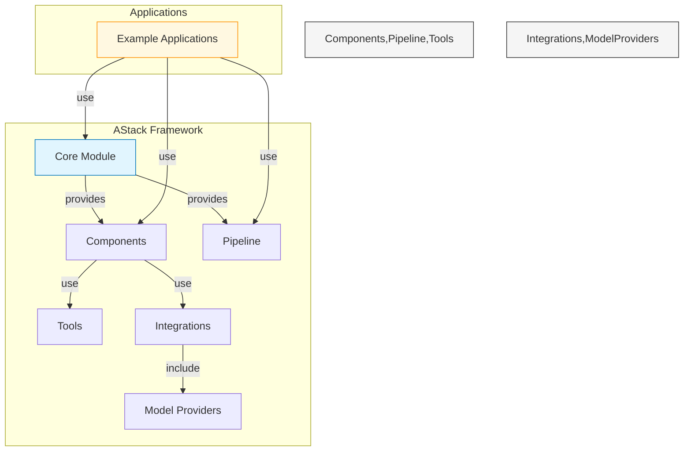

## Getting Started

### Prerequisites

- Node.js (v18 or higher)
- npm or pnpm

### Installation

```bash
# Clone the repository
git clone https://github.com/astack-tech/astack.git
cd astack

# Install dependencies
pnpm install

# Build the packages
pnpm run build
```

### Examples Directory

The `examples/` directory contains sample applications. Read each example’s README for its API keys, configuration, and run commands.

## Examples

### Agent with Tools

The agent uses tools to read and write files. Components send data through event-driven port connections.

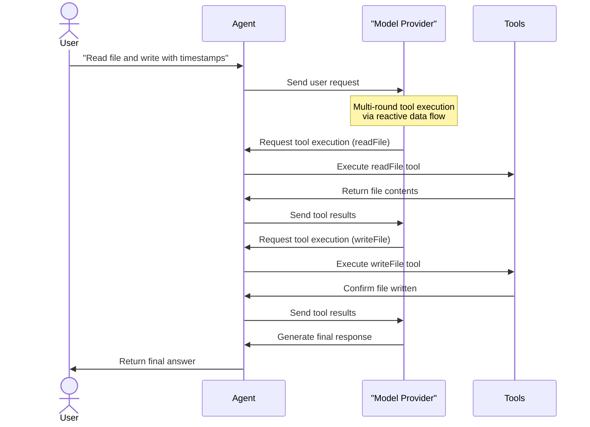

The agent can call tools more than once in a conversation. It adds each tool result to the context before it requests the next model response.

### Research Pipeline

The research pipeline searches the web, analyzes page content, and generates a report. Each component handles one part of the workflow.

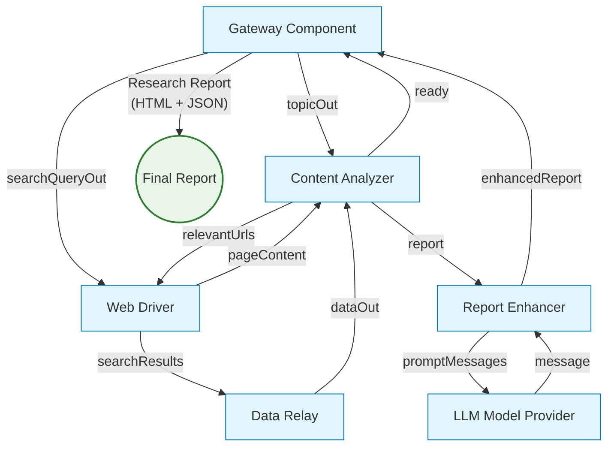

The pipeline connects web search, content extraction, and model analysis. The report includes sections and source citations.

## Code Examples

### Creating a Simple Agent with Tools

```typescript
import { Agent } from '@astack-tech/components';
import { readFile } from 'node:fs/promises';
import { createTool } from '@astack-tech/tools';
import { Deepseek } from '@astack-tech/integrations/model-provider';

// Define tools
const readFileTool = createTool('readFile', 'Read file contents', async ({ filePath }) => {
  if (typeof filePath !== 'string') throw new Error('filePath must be a string');
  return readFile(filePath, 'utf8');
});

// Create model provider
const model = new Deepseek({
  apiKey:
    process.env.DEEPSEEK_API_KEY ||
    (() => {
      throw new Error('Set DEEPSEEK_API_KEY');
    })(),
  model: 'deepseek-chat',
});

// Create Agent
const agent = new Agent({
  model,
  tools: [readFileTool],
  systemPrompt: 'You are a helpful assistant that can read files.',
});

// Run the agent
const result = await agent.run('Please read the README.md file');
```

### Building a Pipeline

Pipeline provides three execution modes:

```typescript
import { Pipeline } from '@astack-tech/core';
// TextSplitter is provided by @astack-tech/components.
// Embedder and VectorStore below are application-defined components.
import { TextSplitter } from '@astack-tech/components';

// Create pipeline
const pipeline = new Pipeline();

// Add components
pipeline.addComponent('splitter', new TextSplitter());
pipeline.addComponent('embedder', new Embedder());
pipeline.addComponent('store', new VectorStore());

// Connect components - direct port connections
pipeline.connect('splitter.out', 'embedder.in');
pipeline.connect('embedder.out', 'store.in');

// Mode 1: Auto-infer endpoint (detects single leaf port)
const result = await pipeline.run('splitter.in', document);

// Mode 2: Explicit endpoint
const result = await pipeline.run('splitter.in', document, 'store.out');

// Mode 3: Multi-output collection (type-safe)
const results = await pipeline.run('splitter.in', document, {
  includeOutputsFrom: ['embedder.out', 'store.out'],
});
// Returns: { 'embedder.out': T, 'store.out': T }
```

**Pipeline Features:**

- **Topology reuse**: Each route builds topology once, reuses for subsequent executions
- **Three Execution Modes**: Auto-inference, explicit endpoint, or multi-output collection
- **Type-Safe Multi-Output**: Full TypeScript type inference for collected outputs
- **Concurrent Execution**: Resolver queue manages multiple concurrent pipeline runs

## Hlang Compatibility

AStack uses [HLang](https://github.com/hlang-tech) for its Flow-Based Programming runtime. AStack provides its own AI components and API. The following sections explain the shared component model and integration points.

### Hlang's Distinctive Features

[HLang](https://github.com/hlang-tech) provides these concepts:

- **Declarative Programming Approach**: Express complex behaviors in a fraction of the code required by traditional methods
- **Human-Centric Design**: Intuitive syntax that reduces the learning curve for developers
- **Component-Based Architecture**: Built around composable components that can be assembled into complex systems
- **Type Safety with Flexibility**: Strong typing system that also accommodates the dynamic nature of modern applications

### Technical Integration

AStack maintains complete technical autonomy while offering compatibility with Hlang:

- **Compatible Component Models**: AStack's component approach is structurally compatible with Hlang's flow-based programming model
- **Independent Development**: AStack can be used independently or in conjunction with Hlang's capabilities
- **Complementary Strengths**: Combine AStack's fine-grained component control with Hlang's higher-level abstractions
- **Efficient Execution**: AStack's reactive data flow design enables efficient implementation of workflows defined in either framework

You can connect AStack components through the HLang runtime. The AI packages remain part of AStack.

## Computation model

AStack uses HLang’s monadic composition model. Components transform data, pipelines connect them, and streams carry events. The following examples show the four computation patterns.

### Four Core Computation Patterns

Combine these four patterns to build an AI application:

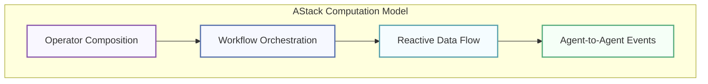

| Computation Pattern        | Description                                                                                                                                                                               | Diagram                                                                                             |
| -------------------------- | ----------------------------------------------------------------------------------------------------------------------------------------------------------------------------------------- | --------------------------------------------------------------------------------------------------- |
| **Operator Composition**   | Each component is a composable transformation operator with pure functional interfaces. Components maintain clear input/output contracts and can be chained together through their ports. | 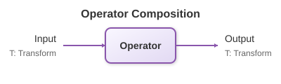     |
| **Workflow Orchestration** | Components can be orchestrated into complex workflows with branching, joining, and conditional execution paths, enabling dynamic routing and parallel processing.                         | 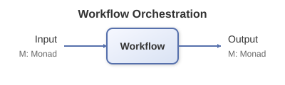 |
| **Reactive Data Flow**     | Implements an event-driven asynchronous data processing model where components respond to data events rather than polling, supporting backpressure handling.                              | 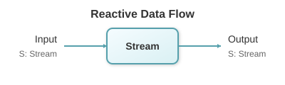          |
| **Agent-to-Agent Events**  | Support for complex interactions and message passing between agents, maintaining context continuity across multiple exchanges, enabling multi-agent coordination.                         | 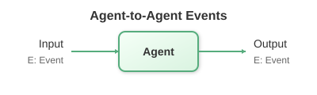            |

#### 1. Operator Composition

The fundamental building block of AStack is operator composition, where each component is a transformational operator that can be composed with others.

```typescript
// Simple operator composition example
const textProcessor = new TextProcessor();
const sentimentAnalyzer = new SentimentAnalyzer();

// Connect output of textProcessor to input of sentimentAnalyzer
pipeline.connect('textProcessor.out', 'sentimentAnalyzer.in');
```

| Feature                   | Description                                                                                  |
| ------------------------- | -------------------------------------------------------------------------------------------- |
| **Functional Purity**     | Components are designed as pure transformations with clear inputs and outputs                |
| **Composition Pattern**   | Components can be linked together with their outputs feeding into inputs of other components |
| **Type Safety**           | The port system ensures type compatibility between connected components                      |
| **Transparent Data Flow** | Data flow between components is explicit and traceable                                       |

#### 2. Workflow Orchestration

Components can be orchestrated into complex workflows with branching, joining, and conditional execution paths.

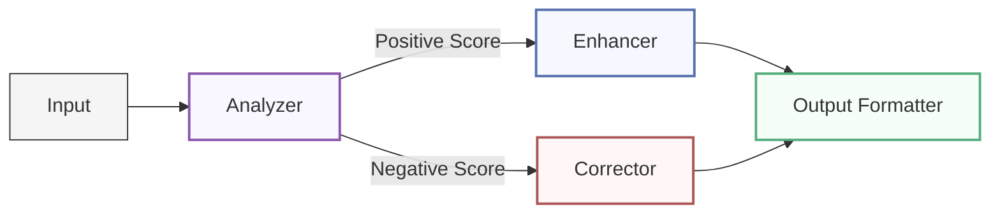

| Feature                   | Description                                                                      |
| ------------------------- | -------------------------------------------------------------------------------- |
| **Dynamic Routing**       | Data can be conditionally routed between components based on content or metadata |
| **Parallel Processing**   | Multiple pathways can execute simultaneously for efficient processing            |
| **Pipeline Construction** | Complex workflows can be built incrementally and modified at runtime             |
| **Error Handling**        | Built-in mechanisms for handling and recovering from errors within the workflow  |

#### 3. Reactive Data Flow

AStack implements a reactive programming model where data flows through the system in response to events or changes.

```typescript
// Reactive component example
class ReactiveProcessor extends Component {
  constructor() {
    super({});
    Component.Port.I('in').attach(this);
    Component.Port.O('out').attach(this);
  }

  _transform($i, $o) {
    // Listen for data on input port
    $i('in').receive(data => {
      // Process data reactively
      const result = this.process(data);
      // Send to output port
      $o('out').send(result);
    });
  }
}
```

| Feature                     | Description                                                         |
| --------------------------- | ------------------------------------------------------------------- |
| **Event-Driven**            | Components respond to data events rather than being actively polled |
| **Asynchronous Processing** | Non-blocking operations allow for efficient resource use            |
| **Backpressure Handling**   | Flow control mechanisms prevent overwhelming downstream components  |
| **Hot vs Cold Streams**     | Support for both persistent (hot) and on-demand (cold) data streams |

#### 4. Agent-to-Agent Event Communication

Agents can exchange events through connected component ports.

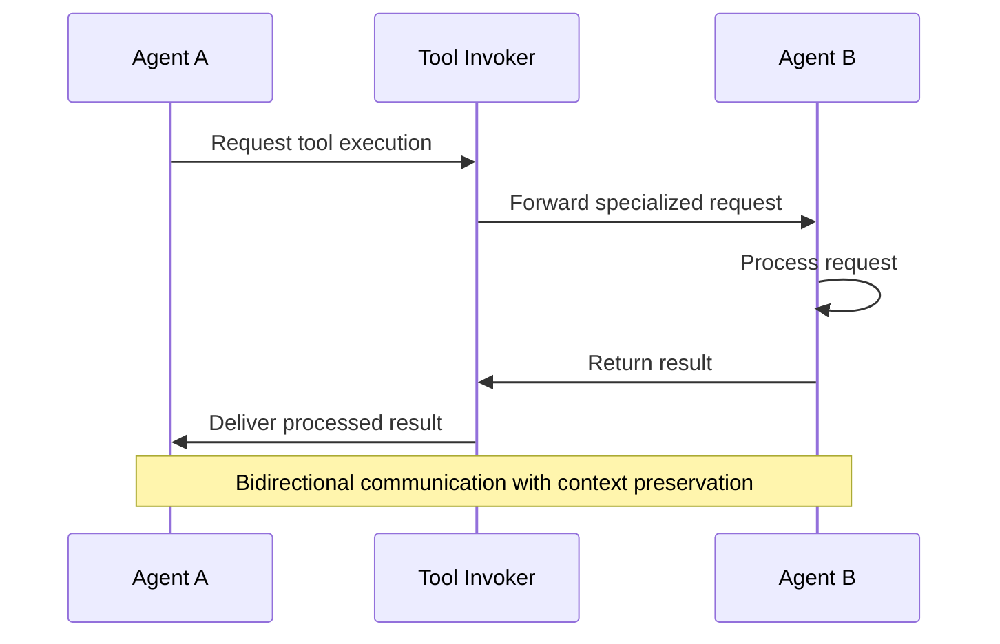

| Feature                      | Description                                                             |
| ---------------------------- | ----------------------------------------------------------------------- |
| **Context Preservation**     | Communication maintains context across multiple exchanges               |
| **Multi-Agent Coordination** | Agents can collaborate on complex tasks through structured interactions |
| **Tool Integration**         | Integration of external tools and services into agent communication     |
| **State Management**         | Optional stateful interactions for maintaining conversation history     |

### Monadic Design Pattern

The patterns use these concepts from functional programming:

- **Encapsulated State**: Each component maintains its own isolated state
- **Chainable Operations**: Operations can be chained together in a fluent interface
- **Composable Transformations**: Complex transformations are built from simple, composable units
- **Error Propagation**: Errors are propagated through the chain in a controlled manner

Each component keeps its input, output, and state contracts. The runtime composes the transformations.

## Packages

AStack is organized into several packages, all published on npm:

| Package                                                                              | Version                                                                                                                       | Description                                             |
| ------------------------------------------------------------------------------------ | ----------------------------------------------------------------------------------------------------------------------------- | ------------------------------------------------------- |
| [@astack-tech/core](https://www.npmjs.com/package/@astack-tech/core)                 | [](https://www.npmjs.com/package/@astack-tech/core)                 | Core functionality and pipeline execution engine        |
| [@astack-tech/components](https://www.npmjs.com/package/@astack-tech/components)     | [](https://www.npmjs.com/package/@astack-tech/components)     | Reusable AI components like Agents and Memories         |
| [@astack-tech/tools](https://www.npmjs.com/package/@astack-tech/tools)               | [](https://www.npmjs.com/package/@astack-tech/tools)               | Tool definitions and implementations                    |
| [@astack-tech/integrations](https://www.npmjs.com/package/@astack-tech/integrations) | [](https://www.npmjs.com/package/@astack-tech/integrations) | Integrations with external services and model providers |

### Installation

Install the beta packages you need:

```bash
# Core package (required)
npm install @astack-tech/core@beta

# Components package (for Agents, Memory, etc.)
npm install @astack-tech/components@beta

# Tools package (for tool implementations)
npm install @astack-tech/tools@beta

# Integrations package (for model providers like OpenAI, Deepseek, etc.)
npm install @astack-tech/integrations@beta
```

Or install all packages at once:

```bash
npm install @astack-tech/core@beta @astack-tech/components@beta @astack-tech/tools@beta @astack-tech/integrations@beta
```

## Documentation

[Read the documentation on DeepWiki](https://deepwiki.com/astack-tech/astack).

Use the [examples](./examples) and [source code](./packages) to check the implementation. The website is at [astack.tech](https://astack.tech).

## Development

### Project Structure

```
astack/
├── packages/
│   ├── core/             # Core framework functionality
│   ├── components/       # Reusable components
│   ├── tools/            # Tool implementations
│   └── integrations/     # External integrations
├── examples/             # Example applications
└── docs/                 # Documentation
```

### Contributing

Read [CONTRIBUTING.md](./.github/CONTRIBUTING.md) before you submit a change.

Key points:

- We use a `dev` branch for active development and new features
- The `master` branch is reserved for stable releases
- All pull requests should target the `dev` branch

Open a pull request against `dev`. Include the checks that you ran.

## License

This project is licensed under the MIT License - see the [LICENSE](LICENSE) file for details.

## Acknowledgements

- Thanks to all contributors who have helped shape AStack
- Inspired by modern AI application architectures and component-based design principles

---

<div align="center">

[Website](https://astack.tech) · [Documentation](https://deepwiki.com/astack-tech/astack) · [Examples](./examples) · [Brand assets](./docs/brand/README.md)

</div>
