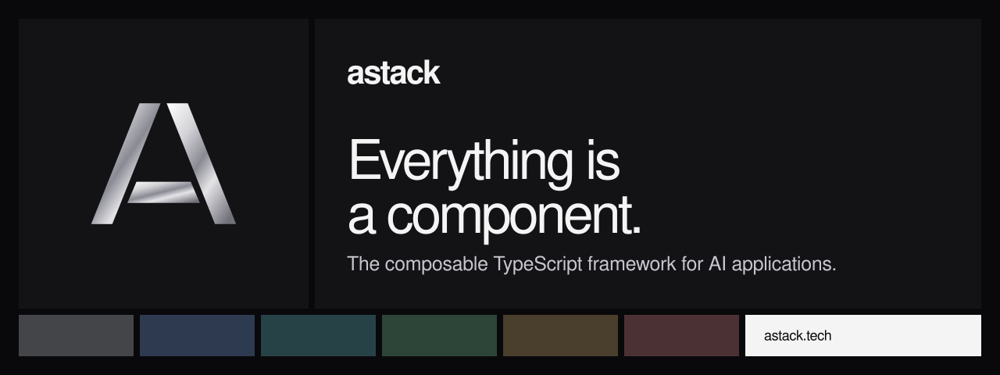

# AStack



[官网](https://astack.tech) · [文档](https://astack.tech/docs) · [示例](https://astack.tech/examples) · [更新日志](https://github.com/astack-tech/astack/releases) · [参与贡献](./.github/CONTRIBUTING.md)

[English](./README.md) · 简体中文

[](https://github.com/astack-tech/astack/actions/workflows/ci.yml) [](https://www.npmjs.com/package/@astack-tech/core) [](./LICENSE)

> **公开测试版。** 测试版之间的 API 可能变化，每次发布的改动见各包的更新日志。

AStack 是用于构建 AI 应用的 TypeScript 框架，只有一条规则：**一切皆组件**。模型、工具、Agent 和你的业务逻辑都是组件。管道（Pipeline）把组件的端口连接成图，数据沿着连接流动。

```typescript
import { Pipeline } from '@astack-tech/core';

// Trim and Uppercase are two small components; see examples/pipeline.
const pipeline = new Pipeline();
pipeline.addComponent('trim', new Trim());
pipeline.addComponent('upper', new Uppercase());
pipeline.connect('trim.out', 'upper.in');

await pipeline.run('trim.in', '  hello  '); // 'HELLO'
```

## 计算模型

| 概念 | 含义                                         | API                                      |
| ---- | -------------------------------------------- | ---------------------------------------- |
| 组件 | 带有具名输入、输出端口的工作单元             | `class X extends Component`              |
| 端口 | 数据通道，输出端口连接到输入端口             | `$i('in').receive()`、`$o('out').send()` |
| 管道 | 组件构成的图，把数据从触发端口运行到终点端口 | `addComponent`、`connect`、`run`         |

组件之间从不直接调用。组件只读取自己的输入端口、写入自己的输出端口，数据去向由管道决定。因此每个组件都小而可测，重新连接图时也不需要修改组件。

每个组件都有两种运行方式：像函数一样调用 `run(input)`；或加入管道，由运行时调用 `_transform($i, $o)`。Agent、多步工作流和路由都是由这些概念组合出的模式，而不是独立的子系统。

运行时是 [HLang](https://github.com/hlang-tech/hlang)——基于 RxJS 的流式编程（Flow-Based Programming）运行时，每条连接都是一个可观察流。

## 与其他框架的对比

AStack 的计算模型是原创的。[PocketFlow](https://the-pocket.github.io/PocketFlow/) 独立得出了相近的思路：一个很小的核心，图本身就是框架。PocketFlow 使用 Python，并以 100 行核心为标志性目标；AStack 不追求行数，追求的是 TypeScript 中类型化、响应式的数据流。[Haystack](https://github.com/deepset-ai/haystack) 启发了 AStack 的 API 形态，但 AStack 不使用 Haystack 的代码。

|          | AStack                                 | PocketFlow                                 | Haystack                  |
| -------- | -------------------------------------- | ------------------------------------------ | ------------------------- |
| 语言     | TypeScript                             | Python                                     | Python                    |
| 工作单元 | 带具名端口的组件                       | 包含 `prep`、`exec`、`post` 的节点         | 带类型化 socket 的组件    |
| 数据传递 | 沿每条连接从输出端口流向输入端口       | 通过节点共同读写的共享存储（shared store） | 沿 socket 之间的连接      |
| 分支     | 组件选择发送到哪个输出端口             | `post` 返回 action，流程沿对应标签的边前进 | 路由组件                  |
| 执行     | 响应式流；同一路由的并发运行按顺序完成 | 流程逐个运行节点，另有异步与并行变体       | 管道运行循环              |
| 设计目标 | 类型化、响应式的数据流模型             | 约 100 行的极简核心                        | 面向搜索与 RAG 的完整框架 |

与 PocketFlow 的主要区别在于状态放在哪里：PocketFlow 的节点共享一个存储；AStack 中每条连接携带这一步的数据，所以每个输入和输出都在图中可见。详见[简介](https://astack.tech/docs/introduction)。

## 安装

需要 Node.js 20 或更高版本。

```bash
npm install @astack-tech/core@beta @astack-tech/components@beta
# 模型提供方与工具
npm install @astack-tech/integrations@beta @astack-tech/tools@beta
```

## 几行代码写一个 Agent

```typescript
import { Agent } from '@astack-tech/components';
import { ModelProvider } from '@astack-tech/integrations';
import { createTool } from '@astack-tech/tools';

const multiply = createTool(
  'multiply',
  'Multiply two numbers.',
  args => Number(args['a']) * Number(args['b'])
);

const agent = new Agent({
  model: new ModelProvider.Deepseek({ apiKey: process.env['DEEPSEEK_API_KEY'] ?? '' }),
  tools: [multiply],
});

const { message, toolCalls } = await agent.run('What is 37 times 43?');
```

## 示例

每个示例只有一个短文件，只讲一个概念。建议按顺序阅读；代码也完整展示在 [astack.tech/examples](https://astack.tech/examples)。

| #   | 示例                                          | 内容                                        | 需要 API Key |
| --- | --------------------------------------------- | ------------------------------------------- | ------------ |
| 1   | [component](./examples/component)             | 定义组件，并像函数一样运行                  | 否           |
| 2   | [pipeline](./examples/pipeline)               | 连接组件，自动推断终点                      | 否           |
| 3   | [routing](./examples/routing)                 | 通过具名输出端口分支                        | 否           |
| 4   | [text-splitter](./examples/text-splitter)     | 用内置组件切分文档                          | 否           |
| 5   | [tools](./examples/tools)                     | 创建工具并执行工具调用                      | 否           |
| 6   | [chat](./examples/chat)                       | 直接调用 DeepSeek，以及在管道中调用         | 是           |
| 7   | [workflow](./examples/workflow)               | 串联大纲、初稿、润色三步                    | 是           |
| 8   | [agent](./examples/agent)                     | 让模型调用工具                              | 是           |
| 9   | [streaming-agent](./examples/streaming-agent) | 流式输出文本与工具事件                      | 是           |
| 10  | [rlm-agent](./examples/rlm-agent)             | 对超出单个提示词容量的代码库提问            | 是           |
| 11  | [http-server](./examples/http-server)         | 通过 Server-Sent Events 提供流式 Agent 服务 | 是           |

```bash
pnpm install && pnpm build
pnpm --filter @astack-examples/pipeline start
```

## 包

| 包                                                     | 内容                                                                 |
| ------------------------------------------------------ | -------------------------------------------------------------------- |
| [`@astack-tech/core`](./packages/core)                 | `Component`、`Pipeline`、`Port`                                      |
| [`@astack-tech/components`](./packages/components)     | `Agent`、`StreamingAgent`、`RLMAgent`、`TextSplitter`、`ToolInvoker` |
| [`@astack-tech/tools`](./packages/tools)               | `createTool`、工具集、组件工具、MCP 工具                             |
| [`@astack-tech/integrations`](./packages/integrations) | 模型提供方（`Deepseek`）                                             |

各包的 README 列出了完整 API。

## 文档

| 页面                                                                                                                              | 主题                         |
| --------------------------------------------------------------------------------------------------------------------------------- | ---------------------------- |
| [简介](https://astack.tech/docs/introduction)                                                                                     | 计算模型与上面的对比         |
| [快速开始](https://astack.tech/docs/getting-started)                                                                              | 安装、第一个组件、第一条管道 |
| [组件](https://astack.tech/docs/components)、[管道](https://astack.tech/docs/pipelines)、[路由](https://astack.tech/docs/routing) | 核心模型                     |
| [工具](https://astack.tech/docs/tools)、[模型提供方](https://astack.tech/docs/model-providers)                                    | Agent 的构建模块             |
| [Agent](https://astack.tech/docs/agents)、[流式输出](https://astack.tech/docs/streaming)、[RLM](https://astack.tech/docs/rlm)     | Agent 模式                   |

文档网站目前为英文。

## 开发

```bash
pnpm install
pnpm verify   # 格式、lint、类型、测试、包检查、构建
```

面向贡献者和 AI 编程 Agent 的规则见 [AGENTS.md](./AGENTS.md)：代码是唯一事实来源；每次改动都从一个失败的测试开始；所有检查都以最严格级别运行且零警告。请向 `dev` 分支提交 PR，并参阅 [CONTRIBUTING.md](./.github/CONTRIBUTING.md) 与 [SECURITY.md](./SECURITY.md)。

## 许可

[MIT](./LICENSE)。感谢 [HLang](https://github.com/hlang-tech) 项目提供运行时，感谢 [Haystack](https://github.com/deepset-ai/haystack) 带来的 API 启发，也感谢每一位贡献者。
