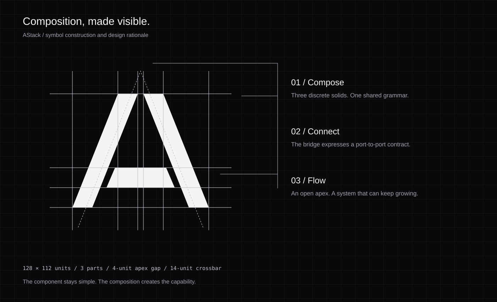

# AStack brand

AStack uses components to build AI applications. The mark expresses that structure with three separate parts.

[Read the brand guide](https://astack.tech/brand) for construction, background usage, and downloads.



## Concept

The two diagonal parts form the sides of an A. The horizontal part connects them. The gaps keep each part distinct.

- **Component:** Each part has a defined shape. It remains visible within the whole mark.
- **Port:** The crossbar connects the two sides. It represents a data contract between components.
- **Composition:** The three parts form a letter that no single part can form alone.
- **Extension:** The open apex leaves space between the sides. It represents a system that accepts new components.

This is a visual interpretation of the architecture. It is not a diagram of the runtime. The design rationale explains the symbol without claiming a scientific or mathematical proof.

## Construction

The source mark uses a 128 × 112 coordinate system. The apex has a 4-unit horizontal gap. The crossbar extends from y=68 to y=82. Its sloped ends remain separate from the diagonal parts.

Use at least 16 units of clear space around the mark. Use the mark at 24 pixels or larger for navigation. The favicon uses a dark backing plate for contrast. The avatar fits both a square and a circular crop.

The silver SVG construction drawing and current SVG mark are the production references. The PNG concept board uses the same geometry and neutral colors.

## Files

| File                                                              | Use                                              |
| ----------------------------------------------------------------- | ------------------------------------------------ |
| [logo.svg](../../assets/brand/logo.svg)                           | Silver gradient mark on a transparent background |
| [logo-white.svg](../../assets/brand/logo-white.svg)               | White mark on a dark background                  |
| [logo-ink.svg](../../assets/brand/logo-ink.svg)                   | Dark mark on a light background                  |
| [avatar.png](../../assets/brand/avatar.png)                       | 512 × 512 organization avatar                    |
| [avatar.svg](../../assets/brand/avatar.svg)                       | Editable avatar source                           |
| [readme-banner.svg](../../assets/brand/readme-banner.svg)         | 1280 × 480 repository banner                     |
| [readme-banner.png](../../assets/brand/readme-banner.png)         | Raster banner export                             |
| [logo-construction.svg](../../assets/brand/logo-construction.svg) | Construction and concept explanation             |
| [social-card.png](../../website/public/brand/social-card.png)     | 1200 × 630 social preview                        |

The files at `assets/logo.svg`, `assets/logo.png`, and `website/public/logo.*` keep their existing paths. Existing links continue to resolve.

## Color and type

| Role             | Value                 |
| ---------------- | --------------------- |
| Graphite surface | `#09090B`             |
| Primary text     | `#F4F4F5`             |
| Silver material  | `#FFFFFF` → `#71717A` |
| Secondary text   | `#A1A1AA`             |

The website uses Geist for text and Geist Mono for code. Use a neutral palette. The silver gradient describes a machined surface. Use the ink variant on light backgrounds. Preserve the three gaps and the proportions when you resize it.

## Writing

Describe what the code does. Name the package, method, or data contract when it helps the reader. Keep one topic in each sentence. Use active verbs and consistent technical names.

The edit uses the writing principles of [ASD-STE100 Issue 9](https://www.asd-ste100.org/) and the `no-ai-slop` skill. It does not claim full dictionary validation or formal STE conformity. Product names, TypeScript identifiers, and established technical terms remain unchanged.

## Sources

- Local source: `packages/core/src/component/index.ts`, `packages/core/src/pipeline/index.ts`, and `packages/components/src/agents/`.
- [DeepWiki overview](https://deepwiki.com/astack-tech/astack) and [Pipeline system](https://deepwiki.com/astack-tech/astack/2.2-pipeline-system). The wiki was indexed on 24 January 2026. Local source takes precedence where the wiki is older.
- Magic UI `AnimatedBeam`, `BorderBeam`, `MagicCard`, and `AnimatedThemeToggler`, copied from `/Users/archer/a-github/magicui/apps/www/registry/magicui/`. See [provenance](../../website/components/magicui/README.md) and the included MIT license.

The new mark, construction drawing, and banners are project assets. Repository licensing applies. The identity does not claim YC investment or affiliation.

## Appearance

The website follows the device theme on the first visit. The navigation toggle saves an explicit light or dark choice. Both themes use neutral surfaces, visible borders, and distinct text levels. Reduced-motion preferences disable the theme reveal and pointer-driven card effects.

## Regenerate and verify

Run these commands from the repository root after installing dependencies:

```sh
node assets/brand/generate.cjs
node assets/brand/check.cjs
```

The generator defines the three paths once and reuses them for every SVG and PNG export. The check compares the geometry in the production symbol, monochrome variants, avatar, banners, and construction diagrams.
