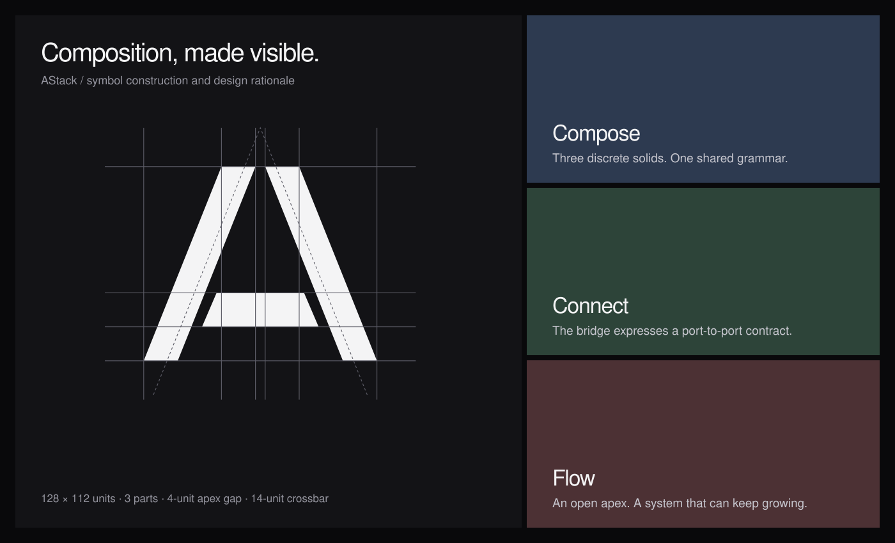

# AStack brand

AStack uses components to build AI applications. The mark expresses that structure with three separate parts.

[Read the brand guide](https://astack.tech/brand) for construction, background usage, and downloads.



## Concept

The two diagonal parts form the sides of an A. The horizontal part connects them. The gaps keep each part distinct.

- **Component:** Each part has a defined shape. It remains visible within the whole mark.
- **Port:** The crossbar connects the two sides. It represents a data contract between components.
- **Composition:** The three parts form a letter that no single part can form alone.
- **Extension:** The open apex leaves space between the sides. It represents a system that accepts new components.

This is a visual interpretation of the architecture. It is not a diagram of the runtime. The design rationale explains the symbol without claiming a scientific or mathematical proof.

## Construction

The source mark uses a 128 × 112 coordinate system. The apex has a 4-unit horizontal gap. The crossbar extends from y=68 to y=82. Its sloped ends remain separate from the diagonal parts.

Use at least 16 units of clear space around the mark. Use the mark at 24 pixels or larger for navigation. The favicon uses a dark backing plate for contrast. The avatar fits both a square and a circular crop.

The SVG construction drawing and the SVG mark are the production references. The PNG concept board is an export of the construction drawing.

## Files

| File                                                                      | Use                                                            |
| ------------------------------------------------------------------------- | -------------------------------------------------------------- |
| [logo.svg](../../assets/brand/logo.svg)                                   | Silver gradient mark on a transparent background               |
| [logo-white.svg](../../assets/brand/logo-white.svg)                       | White mark on a dark background                                |
| [logo-ink.svg](../../assets/brand/logo-ink.svg)                           | Dark mark on a light background                                |
| [avatar.png](../../assets/brand/avatar.png)                               | 512 × 512 organization avatar                                  |
| [avatar.svg](../../assets/brand/avatar.svg)                               | Editable avatar source                                         |
| [readme-banner.svg](../../assets/brand/readme-banner.svg)                 | 1280 × 480 banner for the READMEs and the organization profile |
| [readme-banner.png](../../assets/brand/readme-banner.png)                 | Raster banner export                                           |
| [github-social-preview.svg](../../assets/brand/github-social-preview.svg) | 1280 × 640 GitHub social preview (repository settings)         |
| [github-social-preview.png](../../assets/brand/github-social-preview.png) | Raster export, the file uploaded to GitHub                     |
| [logo-construction.svg](../../assets/brand/logo-construction.svg)         | Construction and concept explanation                           |
| [concept-board.png](../../assets/brand/concept-board.png)                 | Raster export of the construction drawing                      |
| [social-card.svg](../../website/public/brand/social-card.svg)             | 1200 × 630 default social card of the website                  |
| [social-card.png](../../website/public/brand/social-card.png)             | Raster export, used by the website metadata                    |

The files at `assets/logo.svg`, `assets/logo.png`, and `website/public/logo.*` keep their existing paths. Existing links continue to resolve.

## Color and type

The identity is black and silver. The website and the brand images build on it with a board of square tiles: one ground, tiles one tone off it, 8-pixel gaps, and no hairlines or resting shadows.

| Role            | Dark theme            | Light theme |
| --------------- | --------------------- | ----------- |
| Ground          | `#09090B`             | `#F5F5F6`   |
| Tile            | `#131316`             | `#EAEAEC`   |
| Primary text    | `#F4F4F5`             | `#0E0E10`   |
| Secondary text  | `#C6C6CE`             | `#3A3A41`   |
| Silver material | `#FFFFFF` → `#71717A` | ink variant |

Color appears only as block tints. The six hues (silver, blue, aqua, mint, amber, rose) share one OKLCH lightness and chroma and differ only in hue angle; each keeps one meaning on the website, for example blue for `@astack-tech/components`. The tokens live in `website/app/styles/tokens.css`. The brand images use the dark tints mixed 30 % into the tile color: `#444548`, `#2D3A50`, `#274247`, `#2D4439`, `#4A3E2D`, `#4C3134`.

Text uses Geist; code uses Geist Mono. The silver gradient describes a machined surface. Use the ink variant on light backgrounds. Preserve the three gaps and the proportions when you resize the mark.

## Writing

Describe what the code does. Name the package, method, or data contract when it helps the reader. Keep one topic in each sentence. Use active verbs and consistent technical names.

The edit uses the writing principles of [ASD-STE100 Issue 9](https://www.asd-ste100.org/) and the `no-ai-slop` skill. It does not claim full dictionary validation or formal STE conformity. Product names, TypeScript identifiers, and established technical terms remain unchanged.

## Sources

- Local source: `packages/core/src/component/index.ts`, `packages/core/src/pipeline/index.ts`, and `packages/components/src/agents/`.
- [DeepWiki overview](https://deepwiki.com/astack-tech/astack) and [Pipeline system](https://deepwiki.com/astack-tech/astack/2.2-pipeline-system). The wiki was indexed on 24 January 2026. Local source takes precedence where the wiki is older.
- Magic UI `MagicCard`, `AnimatedList`, `BlurFade`, and `AnimatedThemeToggler`, copied from `/Users/archer/a-github/magicui/apps/www/registry/magicui/`. See [provenance](../../website/components/magicui/README.md) and the included MIT license.

The new mark, construction drawing, and banners are project assets. Repository licensing applies. The identity does not claim YC investment or affiliation.

## Appearance

The website follows the device theme on the first visit. The navigation toggle saves an explicit light or dark choice. Both themes separate surfaces by tone, not by borders, and keep distinct text levels. Reduced-motion preferences stop the falling blocks, the marble diagram, the entrance motion, the theme reveal and the pointer-driven light.

## Regenerate and verify

Run these commands from the repository root after installing dependencies:

```sh
node assets/brand/generate.cjs
node assets/brand/check.cjs
```

The generator defines the three paths once and reuses them for every SVG. The banner, the social card, the GitHub social preview and the construction drawing share one board layout and embed Geist, so they render the same in a README, a browser or a social network.

PNG exports:

- The logo, favicon and avatar PNGs come from the generator through `sharp`. Install it next to the script (`npm install --no-save sharp`); without it the generator writes the SVGs and skips these PNGs.
- `sharp` (librsvg) cannot load the embedded font, so the four board images are exported from a browser: open each SVG at its native size (1280 × 480, 1200 × 630, 1280 × 640, 1400 × 850) and save a screenshot as the PNG next to it. Copy `readme-banner.png`, `github-social-preview.svg`, `github-social-preview.png` and `concept-board.png` to `website/public/brand/`, where the brand page offers them for download.

The check compares the geometry in the production symbol, monochrome variants, avatar, banners, and construction diagrams.

After the banner changes, update `profile/assets/banner.svg` and `banner.png` in the `astack-tech/.github` repository, which the organization profiles use. After the social preview changes, upload `github-social-preview.png` under the repository's Settings → Social preview.
