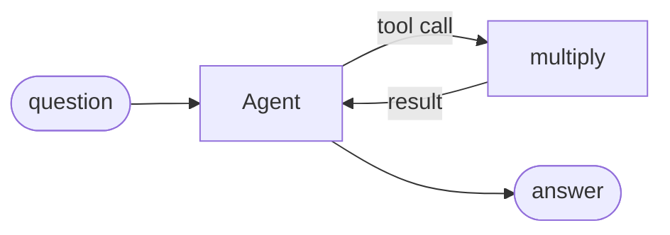

# Agent

Give a model a tool and let it decide when to call it.

**Level:** LLM · **Concept:** [Agents](https://astack.tech/docs/agents) · **Needs:** a model API key (`DEEPSEEK_API_KEY` as written; any provider works)



## What it shows

- The agent loops: ask the model, run requested tools, send results back.
- `maxIterations` bounds the loop. `output.toolCalls` records every call.

## Run

```bash
# Once, from the repository root
pnpm install && pnpm build

export DEEPSEEK_API_KEY=sk-...
pnpm --filter @astack-examples/agent start
```

The full program is [`index.ts`](./index.ts).

Next: [Custom model](../custom-model/)
