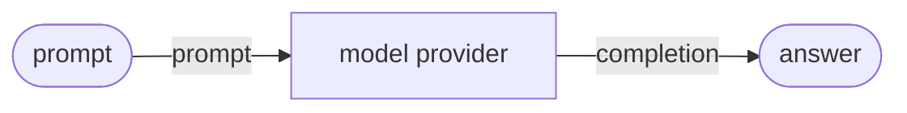

# Chat

Call a model provider directly and inside a pipeline.

**Level:** LLM · **Concept:** [Model Providers](https://astack.tech/docs/model-providers) · **Needs:** a model API key (`DEEPSEEK_API_KEY` as written; any provider works)



## What it shows

- `run(text)` returns text; `chatCompletion(messages)` returns an assistant message.
- In a pipeline the model reads `prompt` or `messages` and writes `completion` or `message`.
- The example uses `Deepseek`, a preset of `OpenAICompatible`. Swap one line to call OpenAI, Qwen, Ollama or any other OpenAI-compatible API.

## Run

```bash
# Once, from the repository root
pnpm install && pnpm build

export DEEPSEEK_API_KEY=sk-...
pnpm --filter @astack-examples/chat start
```

The full program is [`index.ts`](./index.ts).

Next: [Workflow](../workflow/)
