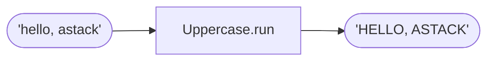

# Component

Define a component and run it as a plain function.

**Level:** Basics · **Concept:** [Components](https://astack.tech/docs/components)



## What it shows

- A component extends `Component` and overrides `run()`.
- `run()` is standalone mode. The same class also works inside a pipeline, as the next example shows.

## Run

```bash
# Once, from the repository root
pnpm install && pnpm build

pnpm --filter @astack-examples/component start
```

The full program is [`index.ts`](./index.ts).

Next: [Pipeline](../pipeline/)
