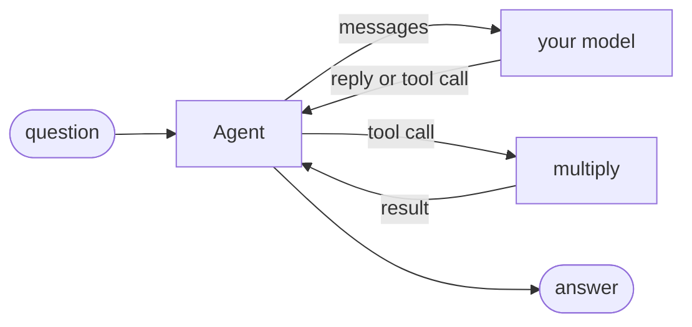

# Custom model

Drive an agent with any model: implement `chatCompletion()` and plug it in.

**Level:** LLM · **Concept:** [Model Providers](https://astack.tech/docs/model-providers) · **Needs:** nothing, runs offline



## What it shows

- An agent depends on the `ModelProvider` interface, not on a vendor. Any object with `chatCompletion(messages)` works.
- The built-in providers have the same shape: `OpenAICompatible` covers OpenAI, DeepSeek, Qwen, Ollama and other OpenAI-compatible APIs.
- The model here follows two rules, so the example runs offline and in CI.

## Run

```bash
# Once, from the repository root
pnpm install && pnpm build

pnpm --filter @astack-examples/custom-model start
```

The full program is [`index.ts`](./index.ts).

Next: [Streaming agent](../streaming-agent/)
