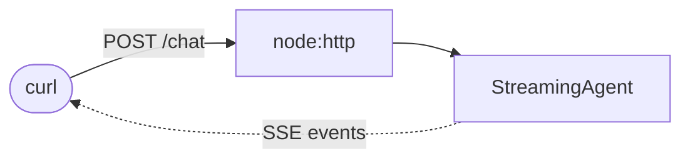

# HTTP server

Serve a streaming agent over HTTP with Server-Sent Events.

**Level:** Advanced · **Concept:** [Streaming](https://astack.tech/docs/streaming) · **Needs:** `DEEPSEEK_API_KEY`



## What it shows

- Each agent event becomes one `data:` line.
- The server uses only `node:http`; any framework works the same way.

## Run

```bash
# Once, from the repository root
pnpm install && pnpm build

export DEEPSEEK_API_KEY=sk-...
pnpm --filter @astack-examples/http-server start
```

The full program is [`index.ts`](./index.ts).
