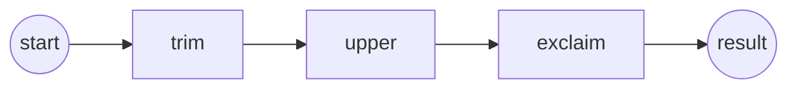

# Pipeline

Connect three components and let the pipeline infer the endpoint.

**Level:** Basics · **Concept:** [Pipelines](https://astack.tech/docs/pipelines)



## What it shows

- `addComponent(name, component)` registers a component; `connect('a.out', 'b.in')` wires two ports.
- With no endpoint, `run()` returns the output of the only terminal component.
- Pass an endpoint such as `'upper.out'` to read an intermediate value.

## Run

```bash
# Once, from the repository root
pnpm install && pnpm build

pnpm --filter @astack-examples/pipeline start
```

The full program is [`index.ts`](./index.ts).

Next: [Routing](../routing/)
