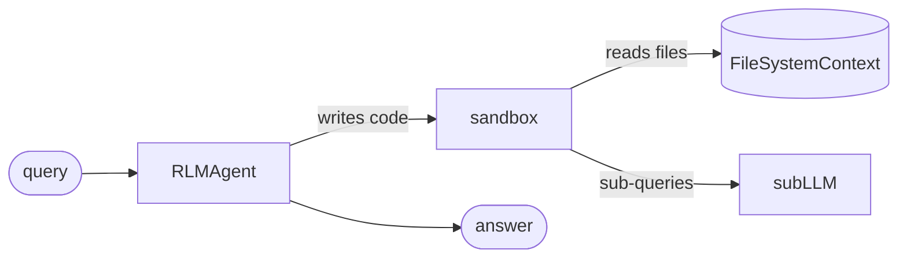

# RLM agent

Answer a question about a source directory that is too large for one prompt.

**Level:** Advanced · **Concept:** [Rlm](https://astack.tech/docs/rlm) · **Needs:** `DEEPSEEK_API_KEY`



## What it shows

- The root model writes code that reads only the files it needs.
- `FileSystemContext` loads files lazily and caches them.

## Run

```bash
# Once, from the repository root
pnpm install && pnpm build

export DEEPSEEK_API_KEY=sk-...
pnpm --filter @astack-examples/rlm-agent start
```

The full program is [`index.ts`](./index.ts).

Next: [HTTP server](../http-server/)
