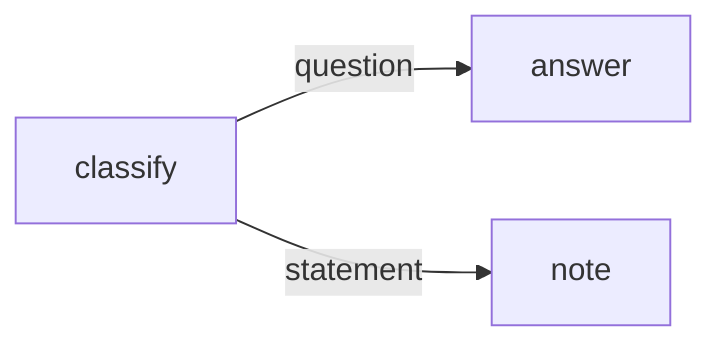

# Routing

Send data to different branches through named output ports.

**Level:** Basics · **Concept:** [Routing](https://astack.tech/docs/routing)



## What it shows

- Attach extra ports with `Component.Port.O(name).attach(this)`.
- Override `_transform($i, $o)` to choose the output port at run time.
- A graph with two terminal components needs an explicit endpoint.

## Run

```bash
# Once, from the repository root
pnpm install && pnpm build

pnpm --filter @astack-examples/routing start
```

The full program is [`index.ts`](./index.ts).

Next: [Text splitter](../text-splitter/)
