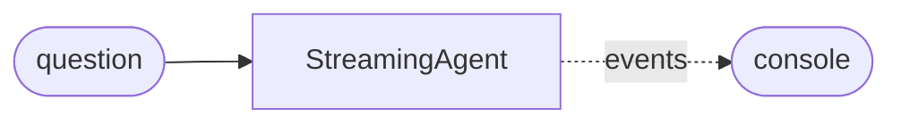

# Streaming agent

Print the agent's text and tool events as they happen.

**Level:** LLM · **Concept:** [Streaming](https://astack.tech/docs/streaming) · **Needs:** a model API key (`DEEPSEEK_API_KEY` as written; any provider works)



## What it shows

- `runStream()` yields `iteration_start`, `assistant_message`, `tool_start`, `tool_result` and `completed` events.
- `assistant_message.content` is the text so far in the current iteration.

## Run

```bash
# Once, from the repository root
pnpm install && pnpm build

export DEEPSEEK_API_KEY=sk-...
pnpm --filter @astack-examples/streaming-agent start
```

The full program is [`index.ts`](./index.ts).

Next: [RLM agent](../rlm-agent/)
