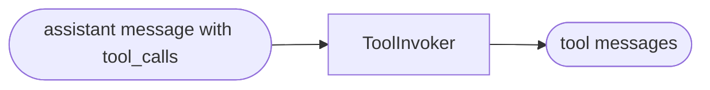

# Tools

Create tools and run tool calls without a model.

**Level:** Basics · **Concept:** [Tools](https://astack.tech/docs/tools)



## What it shows

- `createTool(name, description, fn, schema)` turns a function into a tool.
- `ToolInvoker` runs every call in a message. An unknown tool becomes an error message, not an exception.

## Run

```bash
# Once, from the repository root
pnpm install && pnpm build

pnpm --filter @astack-examples/tools start
```

The full program is [`index.ts`](./index.ts).

Next: [Chat](../chat/)
