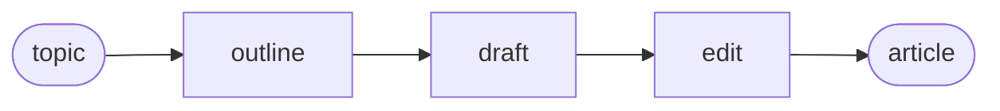

# Workflow

Chain three LLM steps: outline, draft, edit.

**Level:** LLM · **Concept:** [Pipelines](https://astack.tech/docs/pipelines) · **Needs:** `DEEPSEEK_API_KEY`



## What it shows

- Each step is a small component that builds a prompt and calls the model.
- The pipeline, not the steps, decides the order.

## Run

```bash
# Once, from the repository root
pnpm install && pnpm build

export DEEPSEEK_API_KEY=sk-...
pnpm --filter @astack-examples/workflow start
```

The full program is [`index.ts`](./index.ts).

Next: [Agent](../agent/)
