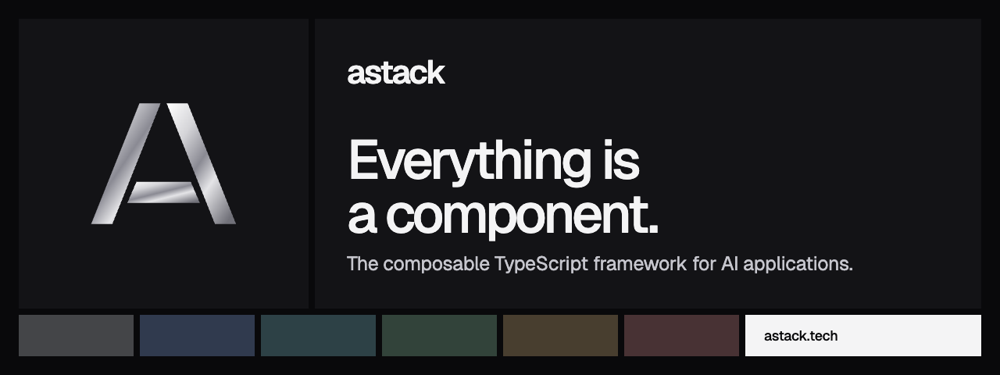

# @astack-tech/components



[](https://www.npmjs.com/package/@astack-tech/components) [](https://github.com/astack-tech/astack/blob/master/LICENSE) [](https://nodejs.org)

Ready-made AStack components: tool-calling agents, a streaming agent, a Recursive Language Model agent, a text splitter and a tool invoker. Every component works standalone and inside a `Pipeline`.

[Website](https://astack.tech) · [Docs](https://astack.tech/docs) · [Examples](https://astack.tech/examples) · [GitHub](https://github.com/astack-tech/astack)

## Install

```bash
npm install @astack-tech/components @astack-tech/core
```

For a model provider, also install `@astack-tech/integrations`. For tools, install `@astack-tech/tools`.

## Quick start

```typescript
import { Agent } from '@astack-tech/components';
import { ModelProvider } from '@astack-tech/integrations';
import { createTool } from '@astack-tech/tools';

const multiply = createTool(
  'multiply',
  'Multiply two numbers.',
  args => Number(args['a']) * Number(args['b'])
);

const agent = new Agent({
  model: new ModelProvider.Deepseek({ apiKey: process.env['DEEPSEEK_API_KEY'] ?? '' }),
  tools: [multiply],
});

const { message, toolCalls } = await agent.run('What is 37 times 43?');
```

## Components

| Component        | Ports          | Description                                                                                                                              |
| ---------------- | -------------- | ---------------------------------------------------------------------------------------------------------------------------------------- |
| `Agent`          | `in` → `out`   | Calls the model, runs requested tools, repeats until the model answers or `maxIterations` is reached.                                    |
| `StreamingAgent` | `in` → `out`   | The same loop. `runStream()` yields `iteration_start`, `assistant_message`, `tool_start`, `tool_result`, `completed` and `error` events. |
| `RLMAgent`       | `in` → `out`   | Answers questions over a large `FileSystemContext` by letting a root model write code that reads files on demand.                        |
| `TextSplitter`   | `text` → `out` | Splits text into chunks of at most `chunkSize` characters, with `overlap`.                                                               |
| `ToolInvoker`    | `in` → `out`   | Runs the tool calls in a message list and returns one `tool` message per call.                                                           |

Also exported: `DefaultMemory`, `FileSystemContext`, `RLMCore`, and the types `AgentConfig`, `AgentInput`, `AgentOutput`, `ModelProvider`, `StreamingChunk`, `LLMProvider`, `RLMInput`, `RLMResult`, `ToolInvokerConfig` and more.

Subpath imports: `@astack-tech/components/agents`, `/text`, `/tool-invoker`.

### Agent options

| Option          | Default                        | Description                                                              |
| --------------- | ------------------------------ | ------------------------------------------------------------------------ |
| `model`         | —                              | Any object with `chatCompletion()`; `streamChatCompletion()` is optional |
| `tools`         | `[]`                           | Tools with `invoke(args)` or `execute(args)`                             |
| `systemPrompt`  | `You are a helpful assistant.` | The tool list is appended                                                |
| `maxIterations` | `10`                           | Maximum model calls per run                                              |
| `verbose`       | `false`                        | Log each step to the console                                             |

Tool failures never throw: they are reported to the model, which decides what to do next.

### RLM safety

`RLMAgent` runs model-written code in a Node.js `vm` context with a 120-second timeout. A `vm` context is not a security boundary. Use RLM only with trusted inputs, or isolate it in its own process or container.

## Learn more

- [Agents](https://astack.tech/docs/agents), [Streaming](https://astack.tech/docs/streaming), [RLM](https://astack.tech/docs/rlm), [Components](https://astack.tech/docs/components)
- Examples: [agent](https://astack.tech/examples/agent), [streaming-agent](https://astack.tech/examples/streaming-agent), [rlm-agent](https://astack.tech/examples/rlm-agent), [text-splitter](https://astack.tech/examples/text-splitter), [tools](https://astack.tech/examples/tools)

## The AStack packages

| Package                                                                                | Purpose                                    |
| -------------------------------------------------------------------------------------- | ------------------------------------------ |
| [`@astack-tech/core`](https://www.npmjs.com/package/@astack-tech/core)                 | `Component`, `Pipeline` and ports          |
| [`@astack-tech/components`](https://www.npmjs.com/package/@astack-tech/components)     | Agents, text splitting and tool invocation |
| [`@astack-tech/tools`](https://www.npmjs.com/package/@astack-tech/tools)               | Tool definitions for agents                |
| [`@astack-tech/integrations`](https://www.npmjs.com/package/@astack-tech/integrations) | Model providers                            |

## License

[MIT](./LICENSE). AStack is in public beta: APIs can change between beta releases. See [CHANGELOG.md](./CHANGELOG.md).
