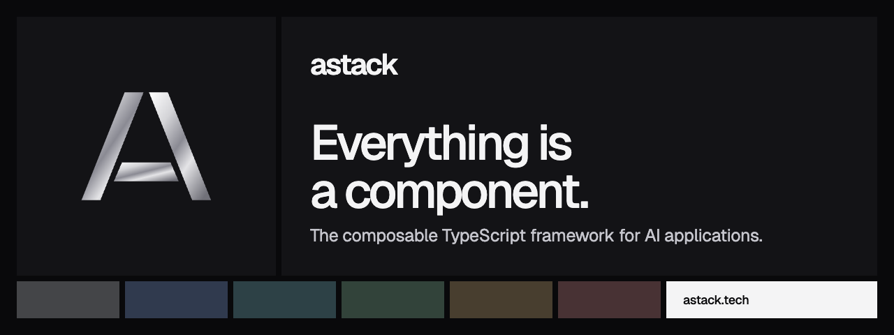

# @astack-tech/core



[](https://www.npmjs.com/package/@astack-tech/core) [](https://github.com/astack-tech/astack/blob/master/LICENSE) [](https://nodejs.org)

The runtime of AStack. Build components with typed ports, connect them into a pipeline, and let data flow through the graph.

[Website](https://astack.tech) · [Docs](https://astack.tech/docs) · [Examples](https://astack.tech/examples) · [GitHub](https://github.com/astack-tech/astack)

## Install

```bash
npm install @astack-tech/core
```

Requires Node.js 20 or later. Ships ESM and CommonJS builds with type declarations.

## Quick start

```typescript
import { Component, Pipeline } from '@astack-tech/core';

class Trim extends Component {
  constructor() {
    super({});
  }

  override run(text: unknown): string {
    return String(text).trim();
  }
}

class Uppercase extends Component {
  constructor() {
    super({});
  }

  override run(text: unknown): string {
    return String(text).toUpperCase();
  }
}

const pipeline = new Pipeline();
pipeline.addComponent('trim', new Trim());
pipeline.addComponent('upper', new Uppercase());
pipeline.connect('trim.out', 'upper.in');

await pipeline.run<string>('trim.in', '  hello  '); // 'HELLO'
```

## API

### `Component`

Base class for every component. Each component has an `in` and an `out` port.

| Member                                              | Description                                                                                    |
| --------------------------------------------------- | ---------------------------------------------------------------------------------------------- |
| `run(input)`                                        | Standalone mode. Override it; the default returns the input.                                   |
| `_transform($i, $o)`                                | Pipeline mode. The default calls `run()` for each value on `in` and sends the result to `out`. |
| `Component.Port.I(name)` / `Component.Port.O(name)` | Create extra ports; call `.attach(this)` in the constructor.                                   |

### `Pipeline`

| Method                                        | Description                                                  |
| --------------------------------------------- | ------------------------------------------------------------ |
| `addComponent(name, component)`               | Register a component. Duplicate names are ignored.           |
| `connect('a.out', 'b.in')`                    | Connect an output port to an input port.                     |
| `getComponent(name)`                          | Return a registered component.                               |
| `run(trigger, input)`                         | Run and infer the endpoint from the only terminal component. |
| `run(trigger, input, endpoint)`               | Run and resolve with the value on `endpoint`.                |
| `run(trigger, input, { includeOutputsFrom })` | Resolve with an object keyed by each listed port.            |

The topology of each route is built once and reused. Concurrent runs of a route resolve in order.

### Types

| Type         | Description                                                                                                  |
| ------------ | ------------------------------------------------------------------------------------------------------------ |
| `Port`       | The `$i` / `$o` accessor passed to `_transform`: `receive(callback)`, `send(value)`, `$` (the RxJS subject). |
| `RunOptions` | `{ includeOutputsFrom: string[] }`                                                                           |

Subpath imports: `@astack-tech/core/component`, `@astack-tech/core/pipeline`.

## Learn more

- [API reference](https://astack.tech/docs/api/core): every export, generated from the source
- [Components](https://astack.tech/docs/components), [Pipelines](https://astack.tech/docs/pipelines) and [Routing](https://astack.tech/docs/routing)
- Examples: [component](https://astack.tech/examples/component), [pipeline](https://astack.tech/examples/pipeline), [routing](https://astack.tech/examples/routing)

## The AStack packages

| Package                                                                                | Purpose                                    |
| -------------------------------------------------------------------------------------- | ------------------------------------------ |
| [`@astack-tech/core`](https://www.npmjs.com/package/@astack-tech/core)                 | `Component`, `Pipeline` and ports          |
| [`@astack-tech/components`](https://www.npmjs.com/package/@astack-tech/components)     | Agents, text splitting and tool invocation |
| [`@astack-tech/tools`](https://www.npmjs.com/package/@astack-tech/tools)               | Tool definitions for agents                |
| [`@astack-tech/integrations`](https://www.npmjs.com/package/@astack-tech/integrations) | Model providers                            |

## License

[MIT](./LICENSE). AStack is in public beta: APIs can change between beta releases. See [CHANGELOG.md](./CHANGELOG.md).

