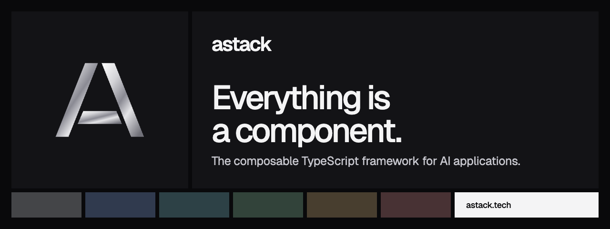

# @astack-tech/integrations



[](https://www.npmjs.com/package/@astack-tech/integrations) [](https://github.com/astack-tech/astack/blob/master/LICENSE) [](https://nodejs.org)

Model providers for AStack. Each provider is a component: call it directly, use it in a pipeline, or pass it to an agent.

[Website](https://astack.tech) · [Docs](https://astack.tech/docs) · [Examples](https://astack.tech/examples) · [GitHub](https://github.com/astack-tech/astack)

## Install

```bash
npm install @astack-tech/integrations @astack-tech/core
```

## Quick start

```typescript
import { ModelProvider } from '@astack-tech/integrations';

const model = new ModelProvider.Deepseek({ apiKey: process.env['DEEPSEEK_API_KEY'] ?? '' });

const text = await model.run('What is flow-based programming?');
const reply = await model.chatCompletion([{ role: 'user', content: 'Hello' }]);
```

`Deepseek` and `OpenAICompatible` are also available from the subpath: `import { Deepseek, OpenAICompatible } from '@astack-tech/integrations/model-provider'`.

## Deepseek

Uses the OpenAI-compatible DeepSeek API through the official `openai` client.

| Option               | Default                       | Description                                                          |
| -------------------- | ----------------------------- | -------------------------------------------------------------------- |
| `apiKey`             | —                             | DeepSeek API key                                                     |
| `model`              | `deepseek-chat`               | Model name                                                           |
| `baseURL`            | `https://api.deepseek.com/v1` | API base URL                                                         |
| `temperature`        | `0.7`                         | Sampling temperature                                                 |
| `maxTokens`, `topP`  | not sent                      | Optional sampling limits                                             |
| `systemPrompt`       | none                          | Added before every request                                           |
| `rawTools` / `tools` | none                          | Tools as `{ name, description, parameters }` or in the OpenAI format |
| `verbose`            | `false`                       | Log API errors to the console                                        |

| Method                                                          | Returns                                                        |
| --------------------------------------------------------------- | -------------------------------------------------------------- |
| `run(prompt)`                                                   | Text                                                           |
| `run(messages)`, `chatCompletion(messages, { temporaryTools })` | Assistant message with `content`, `tool_calls` and `usage`     |
| `streamChatCompletion(messages, options)`                       | Async generator of text, tool-call and usage chunks            |
| `generateCompletion(prompt)`                                    | Text, or the JSON assistant message when the model calls tools |

Messages are checked before the request: the role must be `system`, `user`, `assistant` or `tool`, and a `tool` message needs `tool_call_id`. Otherwise the call fails without reaching the API.

| Pipeline input port | Output port  |
| ------------------- | ------------ |
| `prompt`            | `completion` |
| `messages`          | `message`    |

`Deepseek` satisfies the `ModelProvider` interface of `@astack-tech/components`, so it can drive `Agent` and `StreamingAgent` directly.

## OpenAICompatible

Calls any API that speaks the OpenAI chat completions protocol: OpenAI and the compatible endpoints of DeepSeek, Qwen, Moonshot, Ollama, vLLM and others. `Deepseek` is this provider with DeepSeek's defaults, so methods, ports and the other options are the same.

```typescript
import { ModelProvider } from '@astack-tech/integrations';

const model = new ModelProvider.OpenAICompatible({
  apiKey: process.env['OPENAI_API_KEY'] ?? '',
  model: 'gpt-4o-mini',
});
```

| Option    | Default                     | Description                      |
| --------- | --------------------------- | -------------------------------- |
| `apiKey`  | —                           | API key of the provider          |
| `model`   | —                           | Model name (required)            |
| `baseURL` | `https://api.openai.com/v1` | API base URL                     |
| `name`    | `The model API`             | Provider name in errors and logs |

## Learn more

- [API reference](https://astack.tech/docs/api/integrations): every export, generated from the source
- [Model providers](https://astack.tech/docs/model-providers), including how to write your own
- Example: [chat](https://astack.tech/examples/chat)

## The AStack packages

| Package                                                                                | Purpose                                    |
| -------------------------------------------------------------------------------------- | ------------------------------------------ |
| [`@astack-tech/core`](https://www.npmjs.com/package/@astack-tech/core)                 | `Component`, `Pipeline` and ports          |
| [`@astack-tech/components`](https://www.npmjs.com/package/@astack-tech/components)     | Agents, text splitting and tool invocation |
| [`@astack-tech/tools`](https://www.npmjs.com/package/@astack-tech/tools)               | Tool definitions for agents                |
| [`@astack-tech/integrations`](https://www.npmjs.com/package/@astack-tech/integrations) | Model providers                            |

## License

[MIT](./LICENSE). AStack is in public beta: APIs can change between beta releases. See [CHANGELOG.md](./CHANGELOG.md).
