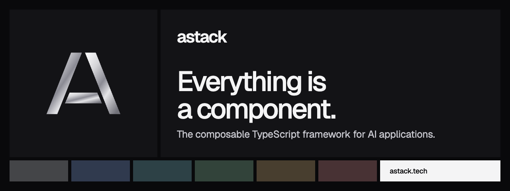

# @astack-tech/tools



[](https://www.npmjs.com/package/@astack-tech/tools) [](https://github.com/astack-tech/astack/blob/master/LICENSE) [](https://nodejs.org)

Tool definitions for AStack agents. Turn a function, a component or an MCP method into a tool that a model can call.

[Website](https://astack.tech) · [Docs](https://astack.tech/docs) · [Examples](https://astack.tech/examples) · [GitHub](https://github.com/astack-tech/astack)

## Install

```bash
npm install @astack-tech/tools
```

## Quick start

```typescript
import { createTool } from '@astack-tech/tools';

const add = createTool('add', 'Add two numbers.', args => Number(args['a']) + Number(args['b']), {
  type: 'object',
  properties: { a: { type: 'number' }, b: { type: 'number' } },
  required: ['a', 'b'],
});

await add.invoke({ a: 2, b: 3 }); // 5
```

Pass tools to `Agent` or `StreamingAgent` from `@astack-tech/components`.

## API

| Export                                           | Description                                                                                                                  |
| ------------------------------------------------ | ---------------------------------------------------------------------------------------------------------------------------- |
| `createTool(name, description, fn, parameters?)` | Wrap a sync or async function. Errors reject `invoke()`.                                                                     |
| `createToolSet(tools)` / `DefaultToolSet`        | A named collection: `getTool`, `addTool`, `removeTool`, `getTools`, `size`. The first tool with a name wins.                 |
| `createComponentTool(config)` / `ComponentTool`  | Expose a component's `run()` as a tool, with optional `transformArgs` and `transformResult`.                                 |
| `createMCPTool(config)` / `MCPTool`              | Call `mcpClient.call(serviceName, methodName, args)`. Errors are rethrown as `MCP call failed: …` with the original `cause`. |

Types: `Tool`, `ToolParameters` (JSON Schema), `ToolCall`, `ToolCallResult`, `ToolSet`, `ToolFunction`, `ComponentToolConfig`, `MCPToolConfig`, `MCPClient`.

A tool is any object with `name`, `description`, optional `parameters` and `invoke(args): Promise<unknown>`. You can implement the `Tool` interface directly.

## Learn more

- [API reference](https://astack.tech/docs/api/tools): every export, generated from the source
- [Tools](https://astack.tech/docs/tools) and [Agents](https://astack.tech/docs/agents)
- Examples: [tools](https://astack.tech/examples/tools), [agent](https://astack.tech/examples/agent)

## The AStack packages

| Package                                                                                | Purpose                                    |
| -------------------------------------------------------------------------------------- | ------------------------------------------ |
| [`@astack-tech/core`](https://www.npmjs.com/package/@astack-tech/core)                 | `Component`, `Pipeline` and ports          |
| [`@astack-tech/components`](https://www.npmjs.com/package/@astack-tech/components)     | Agents, text splitting and tool invocation |
| [`@astack-tech/tools`](https://www.npmjs.com/package/@astack-tech/tools)               | Tool definitions for agents                |
| [`@astack-tech/integrations`](https://www.npmjs.com/package/@astack-tech/integrations) | Model providers                            |

## License

[MIT](./LICENSE). AStack is in public beta: APIs can change between beta releases. See [CHANGELOG.md](./CHANGELOG.md).
